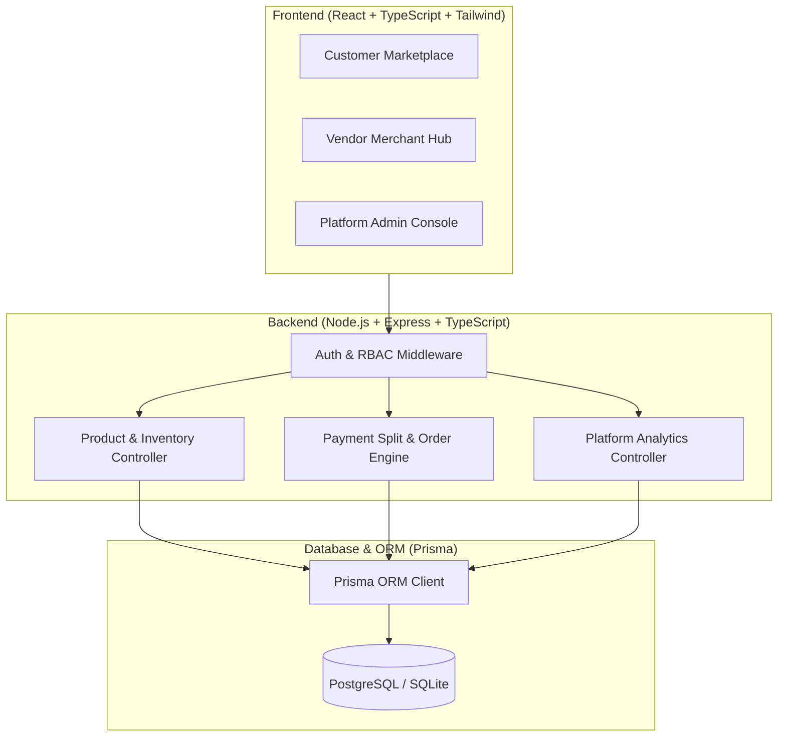

# Project FS-01: Multi-Vendor E-Commerce Marketplace

**Internship:** Nexvia Technologies  
**Student:** Hrithik Sarkar (`NEX-INT-2026-1493`)  
**Track:** Full-Stack Development  
**Submission Deadline:** 20 November 2026  

---

## 1. Project Overview

An Amazon/Etsy-style multi-vendor online marketplace engineered with React, TypeScript, Node.js, Express, PostgreSQL, Prisma ORM, Tailwind CSS, and Docker. 

### Key Capabilities
- **Multi-Vendor Storefront:** Multiple independent sellers manage their own storefronts and product inventory.
- **Unified Multi-Vendor Cart & Checkout:** Customers can place an order containing items from multiple vendors in a single transaction.
- **Automated Payment Split & Commission Logic:** The system automatically calculates platform commission (10–12%) and distributes net payouts directly to individual vendor balances upon transaction completion.
- **Vendor Merchant Dashboard:** Product CRUD, real-time inventory tracking, and order fulfillment status updates (`PROCESSING` $\rightarrow$ `SHIPPED` $\rightarrow$ `DELIVERED`).
- **Super Admin Console:** Platform GMV metrics, commission revenue tracking, vendor store verification, and order auditing.
- **Instant Role Switcher:** Pre-configured demo accounts allowing evaluators to seamlessly test the application as **Customer**, **Vendor**, or **Super Admin** without manual relogging.

---

## 2. System Architecture



---

## 3. Database Schema (Prisma ORM)

```prisma
model User {
  id            String    @id @default(uuid())
  email         String    @unique
  password      String
  name          String
  role          String    @default("CUSTOMER") // CUSTOMER, VENDOR, ADMIN
  vendorProfile Vendor?
  orders        Order[]
  reviews       Review[]
}

model Vendor {
  id             String    @id @default(uuid())
  storeName      String
  description    String?
  logoUrl        String?
  commissionRate Float     @default(10.0)
  balance        Float     @default(0.0)
  totalSales     Float     @default(0.0)
  products       Product[]
  orderItems     OrderItem[]
}

model Product {
  id           String      @id @default(uuid())
  title        String
  description  String
  price        Float
  stock        Int
  imageUrl     String
  isFeatured   Boolean     @default(false)
  vendor       Vendor      @relation(fields: [vendorId], references: [id])
  category     Category    @relation(fields: [categoryId], references: [id])
  orderItems   OrderItem[]
}

model Order {
  id              String      @id @default(uuid())
  orderNumber     String      @unique
  totalAmount     Float
  platformFee     Float
  status          String
  items           OrderItem[]
}
```

---

## 4. Quick Start (Local Development)

### Prerequisites
- Node.js (v18+)
- npm (v9+)

### Step 1: Start Backend API
```bash
cd backend
npm install
npx prisma db push
npx tsx prisma/seed.ts
npm run dev
```
*API runs at:* `http://localhost:5000`

### Step 2: Start Frontend Application
```bash
cd ../frontend
npm install
npm run dev
```
*Frontend runs at:* `http://localhost:5173`

---

## 5. Demo Credentials for Evaluators

| Role | Email | Password | Access Highlights |
| :--- | :--- | :--- | :--- |
| **Customer** | `customer@test.com` | `password123` | Browse catalog, multi-vendor cart, split checkout, order receipts |
| **Vendor** | `sales@apexelectronics.com` | `password123` | Store dashboard, product listings, fulfill orders, withdrawable balance |
| **Admin** | `admin@nexvia.com` | `password123` | Platform GMV, total commission take rate, vendor approvals |

*(Note: You can also use the role selector pills in the top banner for 1-click switching).*

---

## 6. Docker Deployment

```bash
docker-compose up --build
```
* Frontend: `http://localhost`
* Backend API: `http://localhost:5000`
* PostgreSQL: `localhost:5432`
