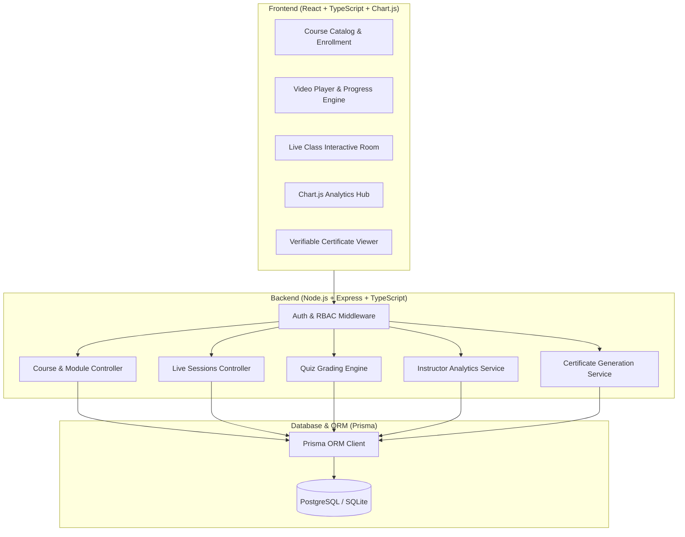

# Project FS-03: Learning Management System with Live Classes

**Internship:** Nexvia Technologies  
**Student:** Hrithik Sarkar (`NEX-INT-2026-1493`)  
**Track:** Full-Stack Development  
**Submission Deadline:** 20 November 2026  

---

## 1. Project Overview

A full-fledged online academy platform engineered with React, TypeScript, Node.js, Express, PostgreSQL, Prisma ORM, Chart.js, Tailwind CSS, and Docker.

### Key Capabilities
- **Video Curriculum & Player:** Structured courses broken into modules and high-definition video lessons with student checklist progress tracking.
- **Interactive Live Classes:** Live masterclass interface with instructor stream, student discussion chat, and hand-raise interaction.
- **Automated Quiz & Certification Engine:** Multiple-choice technical assessments with real-time scoring. Scoring 70%+ automatically issues an official verifiable certificate with unique accreditation ID.
- **Instructor Revenue & Analytics Hub:** Visual metrics powered by **Chart.js**, including 6-month earnings trajectories, enrollment velocity, and course performance distributions.
- **Quick Evaluator Role Switcher:** Instant role switching between **Student**, **Instructor**, and **Admin** with pre-configured sessions.

---

## 2. System Architecture



---

## 3. Database Schema (Prisma ORM)

```prisma
model Course {
  id           String        @id @default(uuid())
  title        String
  slug         String        @unique
  description  String
  thumbnail    String
  price        Float         @default(0.0)
  level        String        @default("Intermediate")
  category     String        @default("Engineering")
  instructor   User          @relation("InstructorCourses", fields: [instructorId], references: [id])
  modules      Module[]
  enrollments  Enrollment[]
  liveSessions LiveSession[]
  quizzes      Quiz[]
  certificates Certificate[]
}

model LiveSession {
  id              String   @id @default(uuid())
  title           String
  description     String?
  scheduledAt     DateTime
  durationMinutes Int      @default(60)
  status          String   @default("SCHEDULED") // SCHEDULED, LIVE, ENDED
  meetingRoomId   String
  course          Course   @relation(fields: [courseId], references: [id])
}

model Quiz {
  id           String         @id @default(uuid())
  title        String
  passingScore Int            @default(70)
  course       Course         @relation(fields: [courseId], references: [id])
  questions    QuizQuestion[]
}

model Certificate {
  id                String   @id @default(uuid())
  certificateNumber String   @unique
  userId            String
  courseId          String
  issueDate         DateTime @default(now())
  grade             String   @default("Excellence with Honors")
}
```

---

## 4. Quick Start (Local Development)

### Prerequisites
- Node.js (v18+)
- npm (v9+)

### Step 1: Start Backend API
```bash
cd backend
npm install
npx prisma db push
npx tsx prisma/seed.ts
npm run dev
```
*API runs at:* `http://localhost:5001`

### Step 2: Start Frontend Application
```bash
cd ../frontend
npm install
npm run dev
```
*Frontend runs at:* `http://localhost:5174`

---

## 5. Demo Credentials for Evaluators

| Role | Email | Password | Access Highlights |
| :--- | :--- | :--- | :--- |
| **Student** | `student@test.com` | `password123` | Video player, live classes room, certification quizzes, certificates |
| **Instructor** | `instructor@nexvia.com` | `password123` | Chart.js revenue analytics, student enrollment distribution, schedule live classes |
| **Admin** | `admin@nexvia.com` | `password123` | Platform oversight and course accreditation |

---

## 6. Docker Deployment

```bash
docker-compose up --build
```
* Frontend: `http://localhost:81`
* Backend API: `http://localhost:5001`
* PostgreSQL: `localhost:5433`
